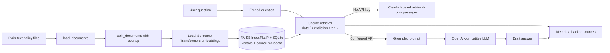

# Independent Future RAG Prototype

This folder is a self-contained research prototype for how a future Ghost Print policy assistant could retrieve changing deletion and retention guidance. It is deliberately not connected to the website, Node server, FastAPI backend, existing APIs, dashboard, authentication, or application database. It does not read challenge datasets or change audit results.

All included policy documents are fictional teaching examples. They are not laws, legal advice, or statements of current regulatory requirements. The prototype can help locate policy text; it cannot determine that a deletion is legally compliant or prove that data was deleted. A human reviewer must validate authoritative sources and evidence.

## What RAG does

Retrieval-Augmented Generation (RAG) finds relevant passages in a maintained knowledge base and supplies those passages to a language model when it drafts an answer. It lets policy content change independently of the model's weights. Updating this index does not train or fine-tune the LLM.

The pipeline in `rag_implementation.py` is real code:

1. `load_documents()` reads `.txt` and `.md` files, parses optional metadata headers, and reports unreadable or invalid files.
2. `split_documents()` breaks long sections into configurable word windows with overlap. Smaller passages fit model context limits, reduce irrelevant surrounding text, and improve retrieval precision; overlap helps preserve meaning at chunk boundaries. Every chunk keeps the original source, version, effective date, jurisdiction, and section.
3. `generate_embeddings()` uses the open-source `sentence-transformers/all-MiniLM-L6-v2` model to turn text into dense numerical vectors. A vector captures semantic features, so related wording can match even when it does not use the exact same keywords.
4. `create_vector_store()` stores each vector and its chunk metadata together in local SQLite and rebuilds a FAISS `IndexFlatIP` exact inner-product index. Since embeddings are normalized, inner product is cosine similarity. FAISS result positions map back to SQLite rows so source metadata is retained. Exact search is intentionally simple for this small prototype; larger collections could use an approximate FAISS index.
5. `retrieve_relevant_chunks()` embeds the question, ranks passages, applies a minimum similarity threshold, and filters by effective date and optional jurisdiction. Top-k and the threshold are configurable.
6. `build_prompt()` supplies only retrieved passages to the LLM and instructs it to treat them as reference data, abstain when unsupported, and avoid legal or deletion-completion claims.
7. `generate_answer()` calls an OpenAI-compatible chat-completions endpoint only when both `LLM_API_KEY` and `LLM_MODEL` are configured. With no key, or if the endpoint fails, the program labels the result as retrieval-only and prints passages rather than pretending a model answered.
8. `display_sources()` prints citations from stored metadata (document, section, version, effective date, source reference). These citations are composed by the program, not trusted to model-generated text.
9. `update_knowledge_base()` explicitly reloads documents, recreates embeddings, and rebuilds the local index. Adding a file alone does not update an existing index.

## Architecture



## Install

Use Python 3.10 or newer. From this directory:

**Windows PowerShell**

```powershell
py -3 -m venv .venv
.\.venv\Scripts\Activate.ps1
python -m pip install --upgrade pip
python -m pip install -r requirements.txt
```

**macOS / Linux**

```bash
python3 -m venv .venv
source .venv/bin/activate
python -m pip install --upgrade pip
python -m pip install -r requirements.txt
```

The embedding model is downloaded from the Hugging Face model hub the first time it is used and then cached by Sentence Transformers. The initial dependency and model download needs network access. The default index is local and the retrieval itself does not send policy documents or questions to an API unless optional LLM generation is configured.

## Run retrieval-only mode

No `.env` file or LLM key is required:

```powershell
python .\rag_implementation.py --reindex
python .\rag_implementation.py --question "What should be checked for backup copies and restore paths?"
```

On macOS/Linux, replace `python` with `python3`. The first command reads the sample policy directory, chunks it, downloads/loads the embedding model, and builds `.local_index/policy_vectors.sqlite3`. The second command embeds the question and prints relevant passages and their source metadata. It explicitly says when no passage meets the similarity threshold.

By default, the example question in the task brief is used. Other options include:

```text
--question "..."      Ask a question
--top-k 3             Return at most three passages
--as-of 2026-09-30    Search policy versions effective by that date
--jurisdiction EU     Optional jurisdiction filter
--min-score 0.35      Raise or lower the cosine similarity threshold
--reindex             Explicitly rebuild after policy files change
--self-test           Check chunk metadata and local vector search without a model/API
```

The current prototype reads Markdown headings as source sections. Plain text without headings is attributed to `General`. Supported metadata fields are `name`, `source_reference`, `version`, `effective_date` (`YYYY-MM-DD`), `jurisdiction`, `supersedes`, and `superseded_by`.

## Optional LLM generation

Copy `.env.example` to `.env`, then set `LLM_API_KEY`, `LLM_MODEL`, and, if needed, `LLM_BASE_URL` or `LLM_CHAT_COMPLETIONS_URL`. The API key is read from the environment and is not stored in code or the index. `.env` and the local index directory are ignored by Git.

The configured provider must expose an OpenAI-compatible `POST /chat/completions` endpoint, unless a full endpoint URL is supplied. The model receives the question and only the retrieved policy passages. A provider error produces a clear retrieval-only fallback. The program appends its own citations from the retrieved metadata so the source list does not depend on the LLM inventing references.

## Demonstrate a policy update without model retraining

The initial index contains `backup_retention_policy_v1.md`. Run a question as of a date after the update's effective date; before the update file is indexed, the result can only cite the initial version:

```powershell
python .\rag_implementation.py --question "What updated expiry review should be performed for each backup class?" --as-of 2026-11-01
```

Copy the later illustrative version into the watched policy folder, then explicitly rebuild:

```powershell
Copy-Item .\sample_policy_updates\backup_retention_policy_v2.md .\sample_policies\
python .\rag_implementation.py --reindex --question "What updated expiry review should be performed for each backup class?" --as-of 2026-11-01
```

The second run embeds the updated policy and stores its version/source metadata. The `superseded_by` relationship in version 1 allows date-aware retrieval to stop returning it once version 2 is effective. No LLM training or fine-tuning occurs. To keep the demonstration repeatable, remove the copied `sample_policies/backup_retention_policy_v2.md` before the initial-version run, or reset the demo folder to its original files. `.local_index/` may be deleted when a clean rebuild is desired.

## Possible future integration

A production service could call a separate policy-retrieval component and pass its cited passages to an investigation assistant. Policy retrieval should advise investigators and point to sources; the evidence engine should continue to establish resource state, and a qualified reviewer should decide how policy applies. The prototype intentionally has no application integration or access to real investigation records.

A production knowledge base would need stronger controls than this demo:

- **Versioning:** preserve immutable policy versions and their source hashes; record which version informed each answer.
- **Jurisdiction:** require a known jurisdiction or clearly state that coverage is unspecified. Do not silently mix jurisdictions.
- **Effective dates:** retrieve only versions in force at the relevant audit or request date, using authoritative timezone and publication metadata.
- **Superseded rules:** maintain explicit replacement relationships and distinguish historical questions from current guidance. This demo filters a simple `superseded_by` relation by effective date.
- **Authority and review:** verify source authenticity, approval, scope, and updates before indexing. Sample text is not an authority source.
- **Evidence separation:** do not treat a policy passage as evidence that a resource was actually deleted or as proof of legal compliance.

## Limitations

- Sample documents are fictional and deliberately avoid real legal citations or claims.
- The default embedding model and cosine threshold are a demonstration choice, not evaluated for production policy retrieval.
- FAISS uses exact search and SQLite stores the vectors and metadata; this is suitable for a small local library, not a large multi-tenant corpus.
- Metadata parsing supports a small YAML-like header, not general YAML. Documents need UTF-8 text and Markdown headings for section-level citations.
- The prototype does not crawl the web, authenticate sources, monitor for policy changes, or automatically re-index files.
- Date/jurisdiction filtering is illustrative. It does not implement legal applicability, precedence, exceptions, conflicting rules, or approval workflows.
- LLM output can still be wrong. Review cited source passages directly; do not use its draft as a deletion verdict.
- The local machine must have Python and be able to download the embedding model before the complete retrieval path can run. Retrieval-only means no LLM API is required; it does not mean the embedding model is optional.
